 

&nbsp;
&nbsp;

 

### Sobre mim

- Escrevo **Python** no dia a dia: automação, back-end e apps que resolvem problemas de verdade.
- Criei o **[Aprova](https://natanaelsantz.github.io/aprova/)**, app gratuito de estudo para concursos públicos, do zero: interface, banco de dados, servidor, testes e publicação automática no Windows e no Android.
- Estudando agora: **Node.js**, **TypeScript**, **Flutter**, nuvem e DevOps.

 

  

  

  

<picture>
  <source media="(prefers-color-scheme: dark)" srcset="https://raw.githubusercontent.com/NatanaelSantz/NatanaelSantz/output/github-snake-dark.svg">
  
</picture>

   
  <i>“O que define um programador não é a linguagem que domina, e sim sua lógica.”</i>
    

